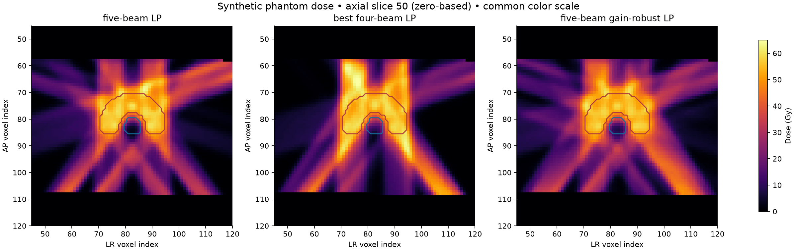
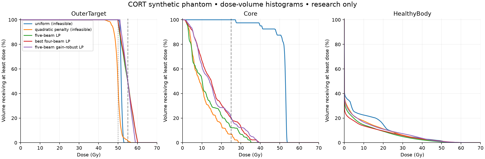
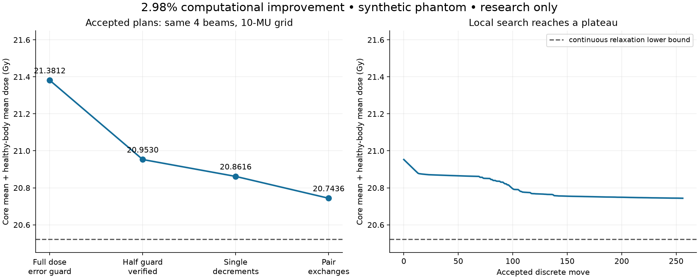

# Pilot results and featured-project assessment

**Recommendation: keep radiotherapy in incubation; do not lead with this exact benchmark as an inaugural featured research project.** The timed trial produced genuine, independently checked computational progress, but the five-angle case is too small and the delivery model too incomplete to support a durable research promise.

## What was delivered

Original SHA-256-pinned CORT TG119 phantom matrices, frozen objectives, a working LP optimizer and conventional quadratic/uniform baselines, exhaustive beam-subset comparison, an independent full-grid dose evaluator, rejected-invalid tests, DVHs and spatial dose plots, synthetic gain sensitivity, numerical infeasibility witnesses, a discrete quantization experiment, and Discovery@Home local project files. Douglas Colkitt is the confirmed maintainer. Nothing was published or connected to a clinical system.

## Reproduction and candidate comparison

The paper Table 3 LP was re-solved: Core mean 0.2488643333 Gy and inclusive BODY mean 0.1020564976 Gy, agreeing with the published rounded 0.2489/0.1021 values. The all-ones statistics and the authors’ supplied original fluences also pass. These are published data controls, not novel plan-quality results. [CORT paper](https://pmc.ncbi.nlm.nih.gov/articles/PMC4326207/).

The research profile uses a synthetic 50 Gy prescription and explicitly chosen dose/fluence limits. Lower scores are better only after feasibility passes. Scores are Core mean + healthy-body mean, in Gy. BODY-minus-target-minus-Core is used for healthy body.

| Candidate | Beams | Feasible | Score | Target D95 | Target D10 | Core D5 |
|---|---:|---|---:|---:|---:|---:|
| uniform | 5 | False | 57.7998 | 50.956 | 52.469 | 53.563 |
| quadratic_penalty | 5 | False | 16.0516 | 47.051 | 51.689 | 25.762 |
| subset_0_72_144_216_288 | 5 | True | 16.9043 | 50.308 | 58.902 | 31.430 |
| subset_0_72_144_216 | 4 | True | 20.5216 | 50.407 | 58.925 | 33.958 |
| subset_0_144_216_288 | 4 | True | 22.3937 | 50.537 | 58.822 | 36.755 |

All 31 nonempty beam subsets were considered. Only the two four-beam subsets above and the five-beam subset were feasible. Every three-beam subset has an independently checked floating-point Farkas contradiction witness; this also rules out smaller subsets. These are numerical checks, not formal exact certificates. The minimum checked contradiction margin is positive. The original primary three-beam task therefore has no feasible leaderboard under v1. Its limits were not relaxed to create a winner.

The continuous four- and five-beam subproblems have negligible numerical primal/dual gaps. Backward greedy already picks the best feasible four-beam subset. There is no evidence of a remaining plan-quality frontier for ordinary continuous fluence optimization on this five-angle instance.

All the listed research-feasible plans fail the separate TG119 easier-case reference goals (target D95 ≥50, target D10 ≤55, Core D5 ≤25 Gy). The original TG119 instructions use nine fields. Research feasibility is intentionally not a commissioning pass. [TG119 instructions](https://www.aapm.org/pubs/tg119/TG119_Instructions_102109.pdf).

## Sensitivity and numerical independence

The nominal four-beam optimum fails under both −2% and +2% global output changes: the former misses the target minimum by 1.0 Gy, and the latter exceeds the target maximum by 1.2 Gy. All five four-beam robust subproblems were solver-reported infeasible. A separate five-beam robust candidate passes all frozen dose constraints at gains 0.98, 1.00 and 1.02; its nominal score is 21.1894 Gy, versus 16.9043 for nominal five-beam optimization. This is a robustness cost at the same beam budget, not an improvement in nominal score.

Global output gain is a synthetic sensitivity model, not validated setup or anatomical uncertainty. Robustness to its endpoints follows from monotonic nonnegative dose coefficients, but does not imply real-world robustness.

Naive rounding to 1 and 10 MU fails the nominal four-beam constraints. Reweighting Core by 0.5 or 2 changes the tradeoff and does not improve the frozen primary objective. A tighter HiGHS IPM re-solve agrees with the best continuous four-beam score. The maximum discrepancy between optimizer CSR multiplication and independent reverse-order column accumulation is 1.14e-13 Gy.

The independent evaluator reloads original MAT data, converts voxel indices independently, and recomputes all voxel doses and metrics. It shares the original CORT QIB physical influence model. This is independent numerical software, not an independent dose engine or independent-human review.

## Thirty-minute contributor trial

The protocol fixes 20:18–20:48 UTC on 2026-10-20. This was performed by the setup agent, with full prior context, not by a blind external contributor. The baseline and evaluator existed at the start; solver refinements, experiments and verification were part of the trial. Final report packaging may occur afterward. The interval, code base, events and complete witnesses are retained under trial/.

Initial cold-start formulations hit short time limits. Retaining the LP basis during adaptive constraint generation reduced repeated work while checking every original voxel constraint. One published-baseline solve used 2.62 CPU seconds / 16.4 wall seconds. This is method-development evidence, not a controlled speedup claim; unrelated heavy jobs were active.

The meaningful hill-climb came from an explicitly separate **10-MU-grid subtrack**, with unchanged primary dose constraints and objective. First reserve a rowwise rounding-error bound, solve an LP, then round. A half-size guard is heuristic and accepted only after independent evaluation. Local integer decrements and pair exchanges then improve the result. No aperture or machine deliverability is implied.

| Stage, four beams / 10-MU grid | Feasible | Objective (Gy) |
|---|---|---:|
| Naive nearest rounding | No | 20.5235 |
| Full rounding-error guard | Yes | 21.381226 |
| Half guard, independently checked | Yes | 20.952956 |
| Extended pair-exchange search | Yes | 20.743584 |
| Continuous relaxation lower bound | Yes, continuous | 20.521648 |

The accepted discrete improvement is **2.98%** relative to the first feasible guarded-rounding plan. The final candidate is **1.08% above the continuous relaxation bound**. That is an upper bound on its relative suboptimality gap using a numerical lower bound, not a proof of discrete optimality. The other four-beam subset has a larger continuous lower bound. Extended search accepted 256 moves, used 11.98 CPU seconds / 42.33 wall seconds, and stopped with no improving single decrement or tested one-unit pair exchange.

The quarter-size guard had a lower objective but was rejected as infeasible. A direct neighborhood MILP did not produce an incumbent within its allotted budget. Stricter dose-volume active-set and minimax-repair attempts either found their fixed partitions infeasible or timed out; none established a TG119-goal-passing plan. These failures remain in the trial logs. They do not prove the full nonconvex DVH problem impossible.

The final discrete plan has Core D5 about 34.10 Gy and an unconstrained healthy-body maximum about 69.82 Gy. Mean-dose objectives do not control all hot spots. Its target minimum is only 50.00003 Gy, and independent ±2% output-gain checks fail. Thus the nominal score improvement spends dose margin; it is not a robustness or clinical-safety improvement. These limitations must be visible in any public demo.

## Suitability against the featured-pilot criteria

| Criterion | Assessment from this trial |
|---|---|
| Tangible early progress | Yes on quantized research proxies: valid 2.98% improvement and verifier/solver hardening. The original three-beam task is infeasible. |
| Sustained hill-climbing | Weak in v1: five-angle enumeration exhausts beam selection; simple discrete moves plateau quickly. Residual integer gap exists, but one tiny instance is not a durable pipeline. |
| Public demo | Strong concept and clear C-shaped phantom, coverage and healthy-dose visuals. Actual accepted gains are modest; do not dramatize them as cancer-treatment advances. |
| Meaningful research potential | Plausible for validated apertures, larger beam libraries and scenario models. No novel or clinically meaningful result has been established here. |
| Home-PC suitability | Good for this case: CPU only, 418 variables, tens of MB of source data; independent verification is short. Larger cases remain unmeasured. |
| Agent intelligence | Helpful: preserve solver state, derive rounding-error margins, enforce fairness, reject infeasible low scores, and exploit pair exchanges. Off-the-shelf solver compute still performs much of the numerical work. |

## Launch gates and next experiment

Keep the public launcher paused. Douglas Colkitt has agreed to maintain, but review capacity, verifier review and public launch approval remain outstanding. No hub consent is recorded.

Before featuring this topic, (1) have a medical-physics/optimization reviewer approve the research framing and limits; (2) freeze a modest multi-instance discrete benchmark with a physically defensible aperture or delivery model; (3) publish strong reproducible conventional baselines and lower bounds; (4) run several blind contributor sessions on clean home machines with fixed budgets; and (5) demonstrate repeatable accepted gains with useful headroom, not just better initial guesses. A larger angle set must fit a measured CPU/memory budget and have cheap independent witness checks.

The next bounded experiment should compare greedy selection, local replacement and a strong sparse/mixed-integer baseline on more candidate angles or a fixed aperture library. Use the current phantom to validate the evaluator first. Treat that as a new versioned benchmark; do not retroactively modify this scoreboard.

## Review status and reproducibility

All evidence is **author-checked**. An independent code path is not independent-human review. See results/verification.log, results/trial-verification.log and results/tests.log; clean-checkout and protocol validation logs are supplied in the final package. Verifier/frontier changes deserve particular care, and review capacity will limit donor throughput.

This machine had eight logical CPUs, 24 GiB RAM and load average around 58 from unrelated work. The complete comparison took 361.0 wall seconds. An initial verifier run took 22.77 wall seconds / 5.56 CPU seconds with peak RSS about 446 MiB; the final verifier also checks scenarios and has separate fresh-check logs. Timings are descriptive, not controlled benchmarks.

Run scripts/reproduce.sh for witness replay and tests. Regenerate main experiments with python -m rtpilot.run, python -m rtpilot.robust, python -m rtpilot.make_certificates and python -m rtpilot.plot. Regenerate the discrete subtrack with python -m rtpilot.rounding_guard and python -m rtpilot.quantized_local --steps 800 --name extended-pairs. Use the pinned virtual environment as shown in README.md.
